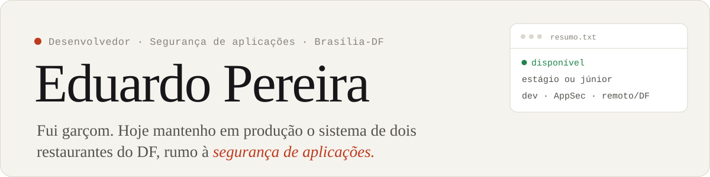

<picture>
  <source media="(prefers-color-scheme: dark)" srcset="assets/cabecalho-escuro.svg">
  
</picture>

  <a href="https://edu-cyber.com.br"><b>Portfólio</b></a> ·
  <a href="https://www.linkedin.com/in/eduardo-pereira-415412370"><b>LinkedIn</b></a> ·
  <a href="https://vextosoft.com.br"><b>Comanda Vexto</b></a> ·
  <a href="https://github.com/edx200/senac-seguranca-da-informacao"><b>Laboratórios</b></a>

Construí e mantenho o **[Comanda Vexto](https://github.com/edx200/comandas-pro-portfolio)**, sistema de gestão para restaurantes que roda todos os dias em dois restaurantes do DF. Fui garçom e anotava pedido em papel; em fevereiro de 2026 comecei a escrever o sistema que eu queria ter tido. Hoje cuido de tudo sozinho: código, publicação, suporte e decisões de segurança.

Estudo Segurança da Informação no Senac-DF e procuro **estágio ou vaga júnior em desenvolvimento ou segurança de aplicações**, presencial em Brasília ou remoto.

---

### O sistema em números

| | |
|---|---|
| **2 restaurantes** | em operação diária, o primeiro desde 08/07/2026 |
| **570+ entregas/mês** | num dos clientes, pelo site do próprio restaurante, sem comissão de aplicativo |
| **759 testes** | 371 nas Cloud Functions (`node:test`) e 388 no app (`flutter_test`) |
| **3 plataformas** | Android, Web (PWA) e Windows, com a mesma base de código |
| **Sem internet** | o salão segue lançando e a cozinha segue imprimindo pela rede local |

**Stack:** Flutter e Dart (BLoC) · Firebase: Firestore, Auth, Hosting, Storage · Cloud Functions em Node.js 22 · JavaScript no cardápio web · impressão térmica ESC/POS por TCP · Gemini API no backend

---

### Segurança não foi item de checklist

Cada funcionalidade começou com uma pergunta: o que um garçom curioso, um cliente esperto ou um robô fariam com isto?

- **Isolamento entre restaurantes nas regras do Firestore.** Toda coleção operacional fica sob `restaurantes/{rid}/`, e uma regra final nega o que não foi declarado.
- **PIN do gerente só no servidor.** O app não lê a coleção de PINs; uma Cloud Function compara o hash SHA-256, bloqueia por 15 minutos depois de 5 tentativas e grava auditoria.
- **Preço decidido no servidor.** O cardápio do cliente envia só quais itens escolheu; o preço sai do catálogo, na Cloud Function.
- **Chaves de API fora do aparelho.** Integrações de IA, fiscal e de pagamento rodam no backend; o app chama um callable.
- **Dinheiro em centavos, nunca `double`.** Erro de arredondamento no caixa é dinheiro que some do dono.

**Achado e corrigido no meu próprio sistema (out/2026):** a regra de atualização de perfil conferia *quem* podia editar, mas não o valor novo do campo `cargo`, e um gerente conseguia se promover a admin dentro do próprio restaurante (OWASP A01, controle de acesso quebrado). A regra passou a negar a promoção, e admin só nasce pelo backend. A lição ficou: validar quem escreve não basta, é preciso validar o que é escrito.

---

### Laboratórios de segurança

Onze laboratórios do curso, em relato de primeira pessoa, no repositório **[senac-seguranca-da-informacao](https://github.com/edx200/senac-seguranca-da-informacao)**:

| | | | |
|---|---|---|---|
| 01 | [Reconhecimento e footprinting](https://github.com/edx200/senac-seguranca-da-informacao/tree/main/atividades/01-reconhecimento-e-footprinting) | 07 | [Persistência](https://github.com/edx200/senac-seguranca-da-informacao/tree/main/atividades/07-persistencia) |
| 02 | [Varredura com Nmap](https://github.com/edx200/senac-seguranca-da-informacao/tree/main/atividades/02-varredura-com-nmap) | 08 | [Políticas de segurança](https://github.com/edx200/senac-seguranca-da-informacao/tree/main/atividades/08-politicas-de-seguranca) |
| 03 | [Tráfego com Wireshark](https://github.com/edx200/senac-seguranca-da-informacao/tree/main/atividades/03-analise-de-trafego-wireshark) | 09 | [Backup e restauração](https://github.com/edx200/senac-seguranca-da-informacao/tree/main/atividades/09-backup-e-restauracao) |
| 04 | [Phishing](https://github.com/edx200/senac-seguranca-da-informacao/tree/main/atividades/04-phishing) | 10 | [Continuidade, RTO e RPO](https://github.com/edx200/senac-seguranca-da-informacao/tree/main/atividades/10-plano-de-continuidade-rto-rpo) |
| 05 | [Força bruta e hardening de SSH](https://github.com/edx200/senac-seguranca-da-informacao/tree/main/atividades/05-forca-bruta) | 11 | [Alta disponibilidade de banco](https://github.com/edx200/senac-seguranca-da-informacao/tree/main/atividades/11-alta-disponibilidade-bd) |
| 06 | [Acesso inicial com exploit](https://github.com/edx200/senac-seguranca-da-informacao/tree/main/atividades/06-acesso-inicial-com-exploit) | | |

> Publico o que ensina a entender e defender. Guardo o que serve de receita pronta para atacar.

---

### Formação e certificações

- **Tecnólogo em Segurança da Informação**, Faculdade de Tecnologia e Inovação Senac-DF · fev/2025 – dez/2026 · monitor voluntário desde nov/2026
- **AWS Cloud Foundations**, Senac-DF com AWS Academy, 50 h · dez/2025
- **Fortinet NSE 1, NSE 2 e NSE 3** (FortiGate 7.6 Operator) · out/2026
- **Introduction to Cybersecurity**, Cisco Networking Academy

Estudando agora: PortSwigger Web Security Academy e a modelagem de ameaças do meu próprio sistema.
